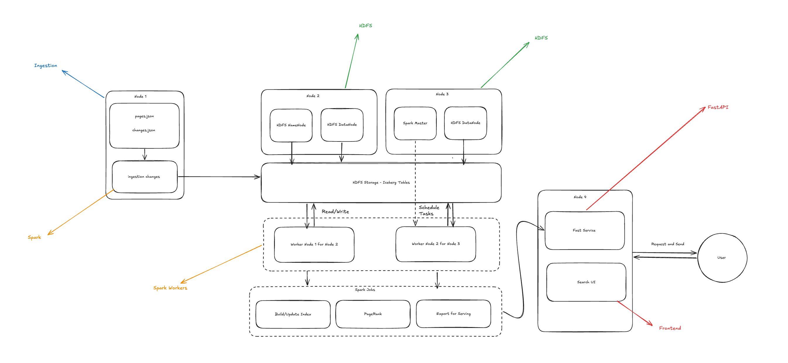

# lucid
A Distributed Search Engine

Creating a Mini-Google like search engine : ) 

# Proposed Architecture: 

_re-drew the architecture so that I understand_

From what i understand, this is the base pipeline 
Accept docs -> clean docs -> stores across multiple machines (ofc, this is BD) -> build index for efficient searching -> ranks the docs -> show it on frontend 

All while handling document updates without losing the previous working version. 

Search engines do this -> 
    - Inverted index -- each word has an index, and it tied to the document containing that word (for example) -> this way, it can directly retrieve the documents from the index. 

**HDFS REPLICATION FACTOR IS 2!**
  
## Node 1 - The reciever 
Recieves, validates and cleans the document -> JSONL files. 
- Reads incoming docs 
- identifying malformed records 
- checking for correct fields 
- removes duplicates
- remove refs to nonexistent docs
- uploads to HDFS. 
  
## Node 2 - HDFS Namenode, Datanode 1, Spark Worker
Storage : D 
HDFS and iceberg (why iceberg? snapshots.)
also does distributed indexing 
parallel distribution 

## Node 3 - Spark Master, Spark Worker, Datanode 2 
- Backup datanode (due to replication factor 2 )
- Hosts the spark drivers for indexing, page rank and export. 
  
## Node 4 - Search and Frontend 
DOES NOT QUERY HDFS/ICEBERG. 
Loads generated parquet file (from node 3) 

Hosts 
- FastAPI Backend 
- searching 
- BM25 - best matching 25 alg -> how relevant a document is to the query 
- Frontend
- pagerank scores 

